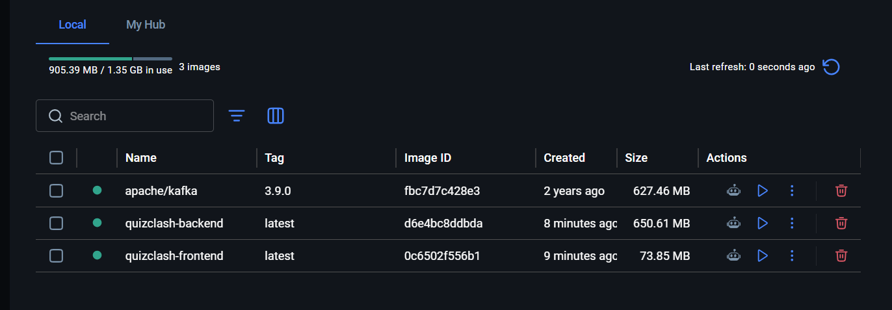
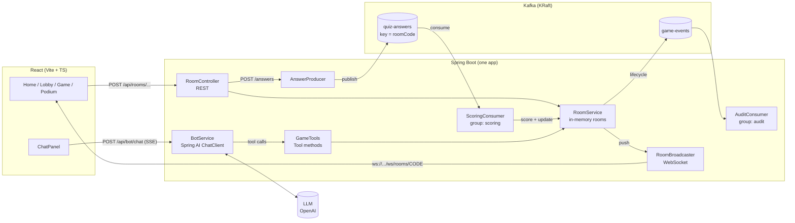

# ⚡ QuizClash

A Kahoot-style **live multiplayer quiz game** with an **AI host**, built to show how
**React**, **Spring Boot**, **Apache Kafka** and **Spring AI** fit together in one small,
readable project.

- Host creates a room → gets a 5-character code
- Players join with code + nickname (no accounts)
- Questions are pushed live; faster correct answers earn more points
- Live leaderboard after every question, podium at the end
- **Quizzy**, the AI host: chats in the lobby, gives hints (for half points),
  generates new questions on a topic **or from your uploaded study material** (PDF, Word,
  PowerPoint, text), and answers "who's winning?" by calling game tools

> New to the codebase? Read [docs/HOW-IT-WORKS.md](docs/HOW-IT-WORKS.md) for a guided tour,
> and [docs/CHATBOT.md](docs/CHATBOT.md) for the AI chatbot and every Spring dependency used.

---

## Quick start

Requirements: Docker + Docker Compose. An OpenAI API key is optional (without it the
game works fully, only the chatbot is offline).

```bash
git clone https://github.com/ganesh0529/quiz-preparation.git
cd quiz-preparation
cp .env.example .env          # put your OPENAI_API_KEY in it (optional)
docker compose up --build
```

| What | URL |
|---|---|
| Game (frontend) | http://localhost:5173 |
| Backend API | http://localhost:8080 |
| Health check | http://localhost:8080/actuator/health |
| Kafka UI (optional) | `docker compose --profile tools up` → http://localhost:8081 |

After the first `docker compose up --build`, Docker Desktop shows the three images the project
uses: Kafka (pulled from Docker Hub), plus the backend and frontend built from this repo.



**Demo:** open http://localhost:5173 in two browser windows (or two tabs). In the first,
click **Create room**. In the second, enter the code and a nickname. Back in the host
window, click **Start game**.

### Running without Docker (for development)

```bash
docker compose up kafka                      # just Kafka, exposed on localhost:29092
cd backend  && mvn spring-boot:run           # Java 21 + Maven
cd frontend && npm install && npm run dev    # Node 20+; Vite proxies /api and /ws to :8080
```

---

## Architecture



**One Spring Boot app, two packages:** `game` (rooms, Kafka, WebSocket) and `bot`
(Spring AI). They are modules, not microservices: easy to run, easy to read.

**Three ways data flows to the browser:**

| Channel | Used for | Why |
|---|---|---|
| REST | Commands: create, join, start, answer, next | Simple request/response, clear errors |
| WebSocket `/ws/rooms/{code}` | Server → all players: new question, progress, results | Push to many clients at once |
| SSE (Server-Sent Events) | Chatbot replies, token by token | One-way stream over plain HTTP |

---

## How Kafka is used

Kafka is the backbone of answer handling.

```
Player clicks answer
   │
   ▼
POST /api/rooms/ABCDE/answers  ──► validate (room open? right question? already answered?)
   │
   ▼
AnswerProducer ──► topic quiz-answers, key = "ABCDE", value = AnswerEvent JSON
   │                (waits for broker ack, then returns 202 Accepted: not scored yet)
   ▼
ScoringConsumer (group "scoring", 3 threads = 3 partitions)
   │   ├─ duplicate? late? → ignore
   │   ├─ correct? speed bonus? hint used? → points
   │   └─ everyone answered? → close question early
   ▼
RoomBroadcaster ──► WebSocket push to every player in room ABCDE
```

**Topic `quiz-answers`**

| | |
|---|---|
| Key | Room code. Kafka hashes the key to choose a partition, so **all answers of one room go to one partition and are processed in order, by one consumer thread**. Different rooms spread across partitions and are scored in parallel. |
| Value | `{ eventId, roomCode, playerId, questionId, answerIndex, clientTimestamp, serverTimestamp }` |
| Producer | `acks=all`, idempotent producer. The endpoint returns **202 Accepted** once the broker has stored the event. |
| Consumer | Group `scoring`, `concurrency = 3`. Idempotent: a redelivered or double-clicked answer is detected and ignored. |

**Topic `game-events`**: lifecycle events (`GAME_CREATED`, `PLAYER_JOINED`, `GAME_STARTED`,
`QUESTION_OPEN`, `QUESTION_CLOSED`, `GAME_ENDED`). A second consumer group, `audit`, reads them
independently. This shows Kafka's pub/sub side: you could add analytics, achievements or
replays as new consumer groups without touching the game code.

**Why not just score inside the HTTP request?** In a demo, you could. Kafka buys you:
answer submission stays fast under a burst (the whole room clicks within a second);
scoring is ordered per room without locks across rooms; answers are durable; and
scoring can scale out by adding partitions and consumer instances.

**Fairness detail:** the speed bonus uses `serverTimestamp` (when the API received the
answer), not `clientTimestamp`, because a browser clock can be wrong or faked.

---

## AI chatbot (Spring AI)

| Feature | Endpoint | Spring AI concept |
|---|---|---|
| 1. AI host in the lobby | `POST /api/bot/chat` | `ChatClient` streaming, system prompt per game phase, `MessageChatMemoryAdvisor` (one memory per room + player) |
| 2. Hints for points | `POST /api/bot/hint` | Streaming; hint marked as used → that answer scores half |
| 3. Question generation | `POST /api/bot/questions` | Structured output: `.call().entity(GeneratedQuestions.class)` |
| 3b. Questions from a document | `POST /api/bot/questions/from-document` | `TikaDocumentReader` extracts the text, then structured output; each question carries its source passage |
| 4. "Who's winning?" | `POST /api/bot/chat` | Tool calling: `@Tool` methods in `GameTools`, room/player passed via `ToolContext` |

Safety choices:
- The chat bot never sees the current question, so it can't leak the answer.
- Tools get the room code and player id from the server (`ToolContext`), not from the
  model, so a player can't talk the bot into reading another room.
- Points are only added to the leaderboard when a question closes, so the tools can't
  reveal who answered correctly mid-question.

Using a different model provider: swap `spring-ai-starter-model-openai` in `pom.xml` for
the Anthropic, Ollama, Azure OpenAI, etc. starter and change the `spring.ai.*` config.
The code only depends on the provider-neutral `ChatModel` / `ChatClient`.

---

## REST API

| Method | Path | Body | Notes |
|---|---|---|---|
| POST | `/api/rooms` | – | → `{ code, hostToken }` |
| GET | `/api/rooms/{code}` | – | Full room snapshot |
| POST | `/api/rooms/{code}/join` | `{ nickname }` | → `{ playerId, nickname, code }` |
| POST | `/api/rooms/{code}/questions` | `{ hostToken, questions[] }` | Host adds questions (lobby only) |
| POST | `/api/rooms/{code}/start` | `{ hostToken }` | Opens question 1 |
| POST | `/api/rooms/{code}/next-question` | `{ hostToken }` | Open → close early; results → next / finish |
| POST | `/api/rooms/{code}/answers` | `{ playerId, questionId, answerIndex, clientTimestamp }` | Publishes to Kafka, **202** |
| GET | `/api/rooms/{code}/leaderboard` | – | |
| POST | `/api/bot/chat` | `{ roomCode, playerId?, message }` | SSE stream |
| POST | `/api/bot/hint` | `{ roomCode, playerId }` | SSE stream |
| POST | `/api/bot/questions` | `{ topic, count, difficulty }` | JSON list |
| POST | `/api/bot/questions/from-document` | multipart: `file`, `count`, `difficulty`, `focus?` | JSON list with `source` passages, max 10 MB |

Errors use RFC 7807 problem details: `{ "status": 409, "detail": "Already answered" }`.

WebSocket messages (`{ type, payload }`): `ROOM_STATE`, `ROOM_UPDATE`, `QUESTION_OPEN`,
`ANSWER_PROGRESS`, `QUESTION_RESULTS`, `GAME_ENDED`.

---

## Project layout

```
quiz-preparation/
├── docker-compose.yml            Kafka (KRaft) + backend + frontend (+ optional Kafka UI)
├── backend/                      Spring Boot 3.5, Java 21
│   └── src/main/java/com/quizclash/
│       ├── config/               topics, WebSocket, scheduler, properties
│       ├── game/                 RoomService, ScoringService, QuestionBank
│       │   ├── kafka/            AnswerProducer, ScoringConsumer, GameEvent*
│       │   ├── ws/               RoomSocketHandler, RoomBroadcaster
│       │   ├── web/              RoomController, error handling
│       │   ├── model/            Room, Player, Question...
│       │   └── view/             JSON shapes sent to clients
│       └── bot/                  BotService, BotController, GameTools, BotPrompts
├── frontend/                     React 18 + TypeScript + Vite
│   └── src/
│       ├── pages/                Home, Lobby, Game, Podium
│       ├── components/           ChatPanel, Countdown, Leaderboard, QuestionGenerator
│       ├── api.ts                REST + SSE client
│       └── useRoomSocket.ts      WebSocket hook with reconnect
└── docs/HOW-IT-WORKS.md          guided tour of the code
```

## Scoring

Correct answer: `1000 × (1 − elapsed / timeLimit / 2)` → 1000 points instantly, 500 at the
buzzer. Wrong or no answer: 0. Hint used: × 0.5. See `ScoringService` and its unit test.

## Limits of v1 (by design)

- **State is in memory**, so it runs as a single backend instance and a restart ends
  all games. Next step: keep room state in a Kafka Streams state store or Redis, and
  route rooms to instances by partition.
- No authentication: the host is identified by a secret `hostToken`, players by `playerId`.
- One consumer error is logged and skipped; production would add a dead-letter topic.

## License

MIT
