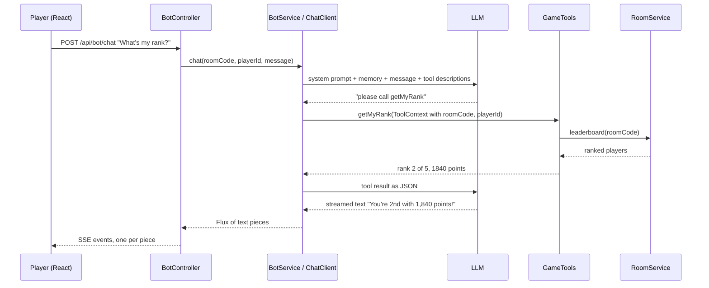

# The QuizClash chatbot: how Quizzy works

Quizzy is the AI host of QuizClash. It is built with **Spring AI** inside the same Spring Boot
app as the game, in the `com.quizclash.bot` package. This page explains what it does, how each
feature works from the click in React down to the model call, and which Spring dependencies
make it possible.

---

## 1. What the chatbot does

| # | Feature | Who uses it | What happens | Endpoint |
|---|---|---|---|---|
| 1 | **AI host in the lobby** | Players and host | Greets each player by nickname when they join, explains the rules, keeps the energy up while waiting | `POST /api/bot/chat` (streamed) |
| 2 | **Hints for points** | Players, during a question | Gives one short clue without revealing the answer; that answer is then worth **half** the points | `POST /api/bot/hint` (streamed) |
| 3 | **Question generation** | Host, in the lobby | Writes new multiple-choice questions on any topic as structured JSON; the host reviews them and adds them to the game | `POST /api/bot/questions` (JSON) |
| 4 | **Live game questions** | Players and host, any time | Answers "who's winning?", "what's my rank?", "how many answered?" by calling Java methods that read the live game | `POST /api/bot/chat` (streamed) |

Features 1 and 4 share one endpoint: it is the same conversation, and the model decides on its
own when it needs to call a game tool.

---

## 2. The pieces

```
backend/src/main/java/com/quizclash/bot/
├── BotController.java   REST endpoints; turns token streams into Server-Sent Events
├── BotService.java      the four features, built on Spring AI's ChatClient
├── GameTools.java       Java methods the model may call (leaderboard, my rank, room status)
└── BotPrompts.java      every prompt in one place

frontend/src/
├── components/ChatPanel.tsx          reusable chat box (lobby, game, podium)
├── components/QuestionGenerator.tsx  host's "Generate questions with AI" panel
├── pages/Game.tsx                    the "Ask Quizzy for a hint" button
└── api.ts                            streamSse(): reads a POST response as SSE
```

`BotService` builds two `ChatClient`s from the auto-configured `ChatModel`:

| Client | Has memory | Has tools | Used for |
|---|---|---|---|
| `chatClient` | Yes, last 20 messages per room + person | Yes, `GameTools` | Features 1 and 4 (conversation) |
| `plainClient` | No | No | Features 2 and 3 (one-shot tasks) |

Hints and question generation are one-off jobs, so they get a stateless client: no chat history
can leak into a hint, and generation is not influenced by earlier conversation.

---

## 3. Feature by feature

### 3.1 AI host and live questions (`/api/bot/chat`)

**Request**

```json
POST /api/bot/chat
{ "roomCode": "K7QXM", "playerId": "6f1c…", "message": "Who's winning?" }
```

`playerId` is left out when the host is chatting.

**What the backend does** (`BotService.chat`)

```java
chatClient.prompt()
    .system(BotPrompts.chatSystem(room.code(), room.phase(), speaker))
    .user(message)
    .tools(tools)
    .toolContext(Map.of("roomCode", room.code(), "playerId", who))
    .advisors(a -> a.param(ChatMemory.CONVERSATION_ID, room.code() + ":" + who))
    .stream()
    .content();
```

Line by line:

1. **`.system(...)`**: the persona and rules. The prompt changes with the game phase:

   | Phase | Quizzy's job |
   |---|---|
   | `LOBBY` | Greet players by name, explain rules, hype the wait |
   | `QUESTION_OPEN` | Never help with the question; point to the Hint button instead |
   | `QUESTION_RESULTS` | React to the standings, hype the next question |
   | `FINISHED` | Congratulate winners, be a good sport |

   It also tells the model the scoring rules so it can explain them, and orders it to use tools
   for any number instead of inventing one.
2. **`.user(message)`**: what the player typed.
3. **`.tools(tools)`**: hands the model the three `@Tool` methods in `GameTools` (section 3.4).
4. **`.toolContext(...)`**: trusted values for the tools, filled in by the server. The model
   never sees or chooses them.
5. **`.advisors(... CONVERSATION_ID ...)`**: picks which memory to use. The key is
   `roomCode:playerId`, so every player has a private conversation that continues from the lobby
   into the game.
6. **`.stream().content()`**: returns a `Flux<String>` of text pieces as the model writes them.

**Lobby greeting.** When a player opens the lobby, `ChatPanel` automatically sends
`"Hi, I'm <nickname> and I just joined!"` without showing it, so Quizzy's welcome appears on its
own.

### 3.2 Hints (`/api/bot/hint`)

**Request**

```json
POST /api/bot/hint
{ "roomCode": "K7QXM", "playerId": "6f1c…" }
```

**Flow**

1. `BotService.hint` first checks the AI is configured, so an offline bot never costs points.
2. `RoomService.useHint` checks the rules under the room lock: a question is open, the player has
   not answered yet, and has not used a hint on this question. It records the hint and returns
   the current question.
3. `plainClient` streams a hint. The prompt contains the question, the 4 options and the correct
   option "for reference only", with hard rules: never state or quote the answer, never say which
   number is right; give a clue or rule out one wrong option; one sentence, at most 25 words.
4. When the player's answer is later scored by the Kafka consumer, `usedHint` is true and
   `ScoringService` halves the points.

Why the model sees the answer at all: a hint that doesn't know the answer is a random guess. The
risk of a leak is reduced by the strict prompt, and it costs the player half their points anyway.

### 3.3 Question generation (`/api/bot/questions`)

**Request and response**

```json
POST /api/bot/questions
{ "topic": "Space", "count": 3, "difficulty": "medium" }

[
  { "question": "Which planet has the longest day?", "options": ["Mercury", "Venus", "Mars", "Jupiter"], "correctIndex": 1 },
  …
]
```

**How it works**

```java
plainClient.prompt()
    .system(BotPrompts.GENERATE_SYSTEM)
    .user("Write 3 medium questions about: Space")
    .call()
    .entity(GeneratedQuestions.class);
```

`.entity(GeneratedQuestions.class)` is Spring AI's **structured output**. Spring AI:

1. generates a JSON Schema from the Java records
   `GeneratedQuestions(List<GeneratedQuestion> questions)` and
   `GeneratedQuestion(String question, List<String> options, int correctIndex)`;
2. adds "reply with JSON matching this schema" to the prompt;
3. parses the model's reply back into those records with Jackson.

The records are wrapped in an object (`{ "questions": [...] }`) because models produce a JSON
object more reliably than a bare array.

The backend then **does not trust the output blindly**:

- drops any question without exactly 4 non-blank options or with `correctIndex` outside 0 to 3;
- **shuffles the options** and recomputes `correctIndex`, because models tend to put the right
  answer first;
- returns at most the number asked for.

The host sees the questions with the correct answer ticked, then clicks **Add to game**, which
calls `POST /api/rooms/{code}/questions` (host token required, lobby only, 30 questions max).

### 3.4 Tool calling: "who's winning?"

`GameTools` exposes three methods to the model:

| Tool | Returns | Example question it answers |
|---|---|---|
| `getLeaderboard` | Rank, nickname, score, correct answers for every player | "Who's winning?" |
| `getMyRank` | The chatting player's rank, score and number of players | "What's my rank?" |
| `getRoomStatus` | Phase, players, question number, seconds left, how many answered | "How many people answered?" |

```java
@Tool(description = "Get the rank and score of the player who is chatting with you.")
public MyRank getMyRank(ToolContext ctx) {
    String playerId = (String) ctx.getContext().get("playerId");
    ...
}
```

**One round trip, step by step**



Spring AI runs that loop for you: it turns the `@Tool` methods into JSON Schemas for the model,
runs the method when the model asks for it, sends the result back, and keeps going until the
model produces text.

**Safety rules built into the tools**

- **No arguments from the model.** Room code and player id come only from `ToolContext`, which
  the server fills from the request. A player cannot say "show me room ABCDE" and have it work.
- **No answers.** No tool returns question text or `correctIndex`.
- **No mid-question spoilers.** Points are stored when an answer is scored but only added to the
  leaderboard when the question closes, so `getLeaderboard` cannot reveal who has already got it right.
- **The chat model never sees the current question**, so it cannot answer it even if asked.

---

## 4. Streaming to React with Server-Sent Events

The chat and hint endpoints return `Flux<ServerSentEvent<String>>`. Spring MVC sees the `Flux` and
keeps the HTTP response open, writing one event per text piece:

```
event:token
data:{"t":"You're "}

event:token
data:{"t":"2nd with 1,840 points!"}

event:done
data:{}
```

Each piece is wrapped in JSON (`{"t": ...}`) so a newline inside the text can't break the SSE
format, which uses blank lines to separate events. A final `done` event tells the browser the
reply is complete.

The browser's built-in `EventSource` only supports GET, and these endpoints are POST (they carry a
JSON body). So `streamSse()` in `frontend/src/api.ts` calls `fetch`, reads `response.body` with a
stream reader, splits it on blank lines, and calls `onToken` for each `token` event. `ChatPanel`
appends each piece to the last bubble, which gives the typing effect.

In Docker, nginx proxies `/api/` with `proxy_buffering off`, otherwise it would hold the stream
and deliver the whole reply at once.

---

## 5. Memory, errors and offline mode

**Memory.** `MessageWindowChatMemory` keeps the last 20 messages per conversation id in memory
(`InMemoryChatMemoryRepository` by default). `MessageChatMemoryAdvisor` adds the history to each
prompt and saves the new user message and reply. It is lost on restart, like the rest of the game
state in v1.

**No API key.** `OPENAI_API_KEY` defaults to the placeholder `not-set`, so the app still starts.
`BotService` sees the placeholder and:

- chat and hint reply with a single "Quizzy is offline" message (and the hint is not used up);
- question generation returns HTTP 503 with a clear message.

**Model errors** (timeout, rate limit, bad key) are caught with `onErrorResume` and turned into a
friendly message in the chat, so the game never breaks because of the AI.

**Game rule errors** (unknown room, hint already used, question closed) are thrown before streaming
starts and come back as normal JSON problem responses, for example
`{"status":409,"detail":"You already used your hint for this question"}`, which the frontend shows.

---

## 6. Spring dependencies and what each one is for

All versions come from the Spring Boot parent and the Spring AI BOM in `backend/pom.xml`.

### Build setup

| Item in `pom.xml` | What it is | Why it's here |
|---|---|---|
| `spring-boot-starter-parent` 3.5.0 | Parent POM | Picks compatible versions for every Spring Boot dependency and configures Java 21 builds |
| `spring-ai-bom` 1.0.1 (in `dependencyManagement`) | Bill of materials | Keeps all Spring AI modules on the same version, so starters are listed without versions |
| `spring-boot-maven-plugin` | Build plugin | Packages the app as one runnable jar (`quizclash-backend.jar`) used by the Dockerfile |

### Runtime dependencies

| Dependency | What it gives you | Where QuizClash uses it |
|---|---|---|
| `spring-boot-starter-web` | Spring MVC, embedded Tomcat, Jackson JSON | All REST controllers (`RoomController`, `BotController`), JSON for Kafka events and WebSocket messages, **SSE responses** for the chatbot (MVC can return a reactive `Flux`) |
| `spring-boot-starter-websocket` | Spring's WebSocket support | `/ws/rooms/{code}`: `RoomSocketHandler` accepts connections, `RoomBroadcaster` pushes questions, progress and results |
| `spring-boot-starter-validation` | Bean Validation (Hibernate Validator) | `@NotBlank`, `@Size`, `@Min`, `@Max` on request records, e.g. chat messages max 500 characters, 1 to 10 generated questions |
| `spring-boot-starter-actuator` | Health and info endpoints | `/actuator/health` for checking the backend is up |
| `spring-kafka` | `KafkaTemplate`, `@KafkaListener`, `KafkaAdmin`, `TopicBuilder` | `AnswerProducer` and `GameEventPublisher` publish; `ScoringConsumer` and `GameEventAuditConsumer` consume; `KafkaTopicsConfig` creates the topics |
| `spring-ai-starter-model-openai` | Spring AI core + the OpenAI client + auto-configuration | **The whole chatbot.** Creates the `ChatModel` bean from `spring.ai.openai.*` settings. Brings in `ChatClient`, `@Tool`, `ToolContext`, chat memory, structured output, and Project Reactor (`Flux`) |

### Test dependencies

| Dependency | What it gives you | Where QuizClash uses it |
|---|---|---|
| `spring-boot-starter-test` | JUnit 5, AssertJ, Mockito, Spring test support | `ScoringServiceTest` |
| `spring-kafka-test` | Embedded Kafka broker for tests | Available for integration tests of the producer and consumer (not written yet) |

### Spring AI classes used, and what each does

| Class / annotation | Package | Role in Quizzy |
|---|---|---|
| `ChatModel` | `org.springframework.ai.chat.model` | The provider-specific model (OpenAI here), auto-configured by the starter |
| `ChatClient` | `org.springframework.ai.chat.client` | Fluent API to build a prompt, attach tools and memory, then `.stream()` or `.call()` |
| `MessageChatMemoryAdvisor` | `org.springframework.ai.chat.client.advisor` | Adds conversation history to each request and saves the reply |
| `ChatMemory`, `MessageWindowChatMemory` | `org.springframework.ai.chat.memory` | Stores the last N messages per conversation id |
| `@Tool` | `org.springframework.ai.tool.annotation` | Marks `GameTools` methods the model is allowed to call; the description tells it when |
| `ToolContext` | `org.springframework.ai.chat.model` | Server-supplied values (room code, player id) passed to tools, hidden from the model |
| `.entity(Class)` | on `ChatClient` call responses | Structured output: JSON Schema in the prompt, JSON parsed into Java records |
| `ServerSentEvent` | `org.springframework.http.codec` (Spring Framework) | One SSE event per text piece in `BotController` |
| `Flux` | `reactor.core.publisher` (Project Reactor) | The stream of text pieces from `.stream().content()` |

### Configuration that drives the chatbot (`application.yml`)

| Property | Default | Meaning |
|---|---|---|
| `spring.ai.openai.api-key` | `${OPENAI_API_KEY:not-set}` | Your key; `not-set` puts the bot in offline mode |
| `spring.ai.openai.chat.options.model` | `${OPENAI_MODEL:gpt-4o-mini}` | Which model to use |
| `spring.ai.openai.chat.options.temperature` | `0.7` | Higher = more playful replies |
| `spring.mvc.async.request-timeout` | `90s` | How long an SSE stream may stay open |

---

## 7. Using a different AI provider

The bot code only uses provider-neutral types (`ChatModel`, `ChatClient`). To switch:

1. In `pom.xml`, replace `spring-ai-starter-model-openai` with another starter, for example
   `spring-ai-starter-model-anthropic` (Claude) or `spring-ai-starter-model-ollama` (local models,
   no key needed).
2. Replace the `spring.ai.openai.*` block in `application.yml` with that provider's properties
   (for example `spring.ai.anthropic.api-key` and `spring.ai.anthropic.chat.options.model`).
3. In `BotService`, change `@Value("${spring.ai.openai.api-key:}")` to the new provider's key
   property. For Ollama, which has no key, set `enabled` to `true`.

Tool calling, streaming and structured output work the same way, as long as the chosen model
supports tool calling.

---

## 8. Try it from the command line

With the stack running (`docker compose up`) and a room created in the browser:

```bash
# Chat (streams tokens; -N turns off curl's buffering)
curl -N -X POST localhost:8080/api/bot/chat \
  -H 'Content-Type: application/json' \
  -d '{"roomCode":"K7QXM","message":"How do I score points?"}'

# Generate questions
curl -X POST localhost:8080/api/bot/questions \
  -H 'Content-Type: application/json' \
  -d '{"topic":"Space","count":3,"difficulty":"easy"}'
```

Replace `K7QXM` with your room code.
